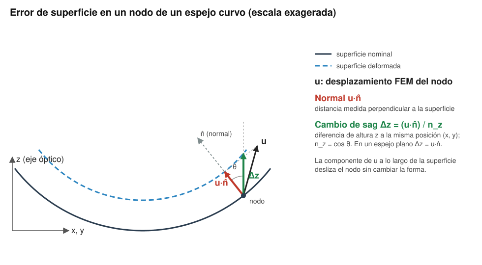

# Mirror Surface Deformation

*Analysis of surface deformation of a mirror* — herramienta Python para el análisis de la deformación de superficies de espejos a partir de resultados de simulaciones de elementos finitos (FEM). Permite calcular RMS, PV, ajuste de polinomios de Zernike, Strehl y PSF, tolerancias de forma ISO 10110-5 y combinaciones de casos de carga, con una interfaz gráfica interactiva y vista 3D de la deformación.

## Características

- **Interfaz gráfica** (GUI tkinter) con paneles de configuración, log de resultados y figura embebida
- **Modo consola** para integración en flujos de trabajo automatizados
- Eliminación de modos de **sólido rígido** (Tx, Ty, Tz, Rx, Ry, Rz) configurables
- **Ajuste polinómico WLS ponderado por área**, normalización pico o RMS, con tabla de coeficientes e índice 1-based de la convención
- **Aperturas y bases**:
  - circular → Zernike, convención **Fringe** o **Noll**
  - anular → **Zernike anulares de Mahajan** (1981), con obscuración detectada de la malla
  - hexagonal → **ortonormales hexagonales de Mahajan–Dai** (2006), vértices en ±X o ±Y
  - rectangular (y cuadrada) → **ortonormales rectangulares de Mahajan–Dai** (2007)
- **Error de superficie**: cambio de sag Δz (recomendado en espejos curvos, incluye el movimiento en el plano) o desplazamiento normal u·n
- **Aporte RMS de cada término**, independiente del número de términos ajustados, y RMS/PV residual acumulado
- Sistema de referencia **global** (Z = eje óptico) o **plano best-fit** (ver [Conceptos](#conceptos))
- Áreas nodales sin triángulos falsos sobre huecos o entrantes del contorno
- Ficheros con **varios casos de carga** apilados (1ª columna = nº de caso)
- Cálculo de **RMS**, **RMS respecto a la media** y **PV** sobre la apertura
- **Calidad óptica**: error de frente de onda en reflexión (2·cosθ·superficie) con λ y ángulo de incidencia configurables, **Strehl** por Maréchal y numérico, y **PSF** por FFT en unidades de λ/D
- **ISO 10110-5:2015**: potencia (A), irregularidad (B), irregularidad rotacionalmente invariante (C), RMSt, RMSi, RMSa, PV robusto (PVr) y PV recortado (PV99.8%), notación `3/A(B/C) RMSx < D` y comprobación frente a una tolerancia
- **Combinación de casos de carga** calculados con la misma malla: gravedad a cualquier ángulo de elevación a partir de casos a ángulos distintos, u(θ) = cosθ·A + sinθ·B (+C), con comprobación de linealidad y barrido de RMS/PV; o combinación lineal Σ cₖ·uₖ
- **Exportación a Zemax OpticStudio y QUADOA**: rejilla de sag (Zemax *Grid Sag* `.dat` y nube x, y, z `.csv` para QUADOA) y coeficientes de Zernike de sag en unidades de lente (Fringe Z1–Z37, Standard/Noll y ANSI Z80.28), de la superficie sin sólido rígido o del residuo tras el ajuste
- **Vista 3D interactiva** de la superficie de deformación con escala Z configurable
- **Informe Word** (español o inglés) con los mapas de la superficie sin sólido rígido y del residuo, RMS, máximo, mínimo, PV, términos eliminados, calidad óptica, tabla ISO 10110-5 y observaciones automáticas
- Coordenadas + valor interpolado al pasar el ratón por encima de los gráficos

## Requisitos

- Python 3.9 o superior
- numpy
- scipy
- matplotlib
- python-docx (solo para los informes Word)

Instalación rápida de dependencias en Windows:

```
instalar_dependencias.bat
```

O directamente:

```bash
pip install numpy scipy matplotlib python-docx
```

## Uso

### Interfaz gráfica (recomendado)

```
ejecutar_gui_fem.bat
```

O directamente:

```bash
python gui_fem_mirror.py
```

La GUI permite cargar el fichero de datos FEM, configurar los parámetros y ejecutar el análisis con un clic. En el bloque **Calidad óptica e ISO 10110-5** se indican las unidades del fichero, la longitud de onda, el ángulo de incidencia y, opcionalmente, una tolerancia ISO a comprobar. Tras el análisis, el botón 🎨 **Vista 3D** abre una ventana interactiva con la superficie de deformación, y el botón 📄 **Generar informe** crea un documento Word en el idioma seleccionado.

El botón 🔭 **Exportar Zemax / QUADOA…** abre una ventana para elegir la superficie (sin sólido rígido, por defecto, o residuo tras el ajuste), las unidades de lente, la resolución de la rejilla, la interpolación y el orden de los Zernike; ver [Exportación a Zemax y QUADOA](#exportación-a-zemax-y-quadoa).

El botón **Combinar casos…** abre una ventana para combinar casos FEM con la misma malla (por ejemplo gravedad a 0° y 45°): genera el fichero del caso combinado a un ángulo dado (absoluto o respecto a un ángulo de referencia), lo analiza con los ajustes de la ventana principal y dibuja el barrido de RMS/PV frente al ángulo.

### Modo consola

Edita los parámetros en `ejecutar_fem_mirror.bat` y ejecútalo, o llama directamente:

```bash
python fem_mirror_analysis.py datos.TXT \
    --rigid 1 1 1 1 1 1 \
    --aperture circular --convention noll \
    --nterms 5 \
    --norm pico \
    --plot
```

`--nterms N` ajusta los N primeros términos de la base (igual que la GUI); `--terms` permite elegir índices concretos (Fringe 0-based; Noll y bases anular, hexagonal y rectangular 1-based). `python fem_mirror_analysis.py --list-terms --convention noll` muestra la tabla de términos.

Calidad óptica e ISO 10110-5:

```bash
python fem_mirror_analysis.py datos.TXT --nterms 4 --units mm \
    --wavelength 632.8 --incidence 0 \
    --iso-spec "3/900 nm (250 nm/100 nm) RMSi < 30 nm"
```

Combinación de casos de gravedad (misma malla; `ruta::caso` para ficheros con varios casos):

```bash
python fem_mirror_analysis.py --gravity g0.TXT 0 --gravity g45.TXT 45 \
    --elevation 60 --ref-elevation 0 --sweep 0 90 15 --save-combined g60.TXT
```

Con tres o más casos, `--constant` añade un término constante (precargas, montaje) y el programa informa del desajuste de linealidad de cada caso. `--combine FICHERO COEF` (repetible) calcula una combinación lineal.

Exportación a Zemax y QUADOA (aquí, el residuo tras quitar pistón, tilts y desenfoque, en mm):

```bash
python fem_mirror_analysis.py datos.TXT --units m --nterms 4 \
    --export salida/espejo --export-surface residuo --export-units mm \
    --export-grid 101 --export-interp linear --export-nmax 10
```

## Conceptos

### Error de superficie: cambio de sag Δz o normal u·n̂



El modelo FEM da el desplazamiento **u** de cada nodo, que en un espejo curvo tiene una componente perpendicular a la superficie y otra a lo largo de ella. Hay dos formas de convertirlo en un error de superficie:

- **Normal u·n̂**: proyección de u sobre la normal local. Es la distancia entre la superficie nominal y la deformada medida perpendicularmente a la superficie.
- **Cambio de sag Δz = (u·n̂)/n_z** (por defecto): diferencia de altura z entre las dos superficies en la misma posición (x, y), con n_z = cos θ la componente z de la normal. Es la magnitud que usa el código óptico para describir la superficie (sag frente a x, y) y la que recomiendan Doyle, Genberg, Michels y Bisson (SPIE 5867, 2005) para superficies curvas.

La componente de u a lo largo de la superficie solo desliza el nodo sobre ella y no cambia la forma; las dos opciones la descartan correctamente. Difieren en el factor 1/cos θ, que crece hacia el borde de los espejos rápidos. En un espejo plano (n_z = 1) coinciden.

### Sistema de referencia: global o plano best-fit

- **Global (Z = eje óptico)**: se usan las coordenadas y desplazamientos tal como vienen del fichero. El eje Z del fichero debe ser el eje óptico, y los giros Rx, Ry, Rz del sólido rígido son alrededor de los ejes del fichero. Es la opción correcta para espejos curvos, segmentos fuera de eje y modelos parciales por simetría.
- **Plano best-fit**: se calcula el plano que mejor se ajusta a los nodos (SVD) y se giran coordenadas y desplazamientos para que su normal sea +Z, sin trasladar el origen. Sirve cuando un espejo **plano** se ha exportado inclinado respecto a los ejes del modelo. No debe usarse en modelos parciales de espejos curvos ni en segmentos fuera de eje, porque allí la normal del plano best-fit no es el eje óptico.

Para un espejo plano exportado con Z = eje óptico las dos opciones dan lo mismo. El programa indica en el registro el ángulo entre la normal best-fit y Z y avisa si supera 1°.

### Normalización de los polinomios: pico o RMS

- **Pico**: cada polinomio de Zernike vale 1 en el borde de la pupila (normalización clásica Fringe). El coeficiente es la amplitud en el borde; por ejemplo, el desenfoque 2ρ²−1 con coeficiente c tiene un PV de 2c.
- **RMS**: cada polinomio tiene RMS unidad sobre la pupila (normalización de Noll). El coeficiente es directamente el RMS que aporta ese término, lo que permite comparar términos entre sí.

La normalización solo cambia el valor de los coeficientes: el residuo, su RMS y su PV son los mismos. Las bases anular, hexagonal y rectangular son siempre ortonormales, es decir, con normalización RMS. La columna «Aporte RMS» de la tabla de coeficientes da la contribución de cada término al RMS con cualquier normalización.

### Notas sobre ISO 10110-5

- Las magnitudes son de **superficie** en nm (1 fringe spacing = λ/2).
- Funciones de ISO 14999-4:2007: tilt = plano best-fit (incluye pistón); RMS = integral sobre la apertura (aquí ponderada por área nodal).
- La esfera best-fit se aproxima paraxialmente por el término ρ² (se avisa si la superficie es rápida), la parte rotacionalmente invariante (óptimo rms = media azimutal) por un ajuste de polinomios pares en ρ, y el PVr según Evans (Opt. Eng. 48(4), 2009) con los 37 términos Zernike Fringe que recomienda ISO 14999-4. ISO 10110-5:2015 limita el PVr a aperturas circulares; en las demás se calcula y se marca como fuera de norma.
- PVr acotado entre 6·RMS del residuo y el PV, y PV99.8% (PV recortado del 99,8 % del área, recorte óptimo de las dos colas) según Murphy (Proc. SPIE 12778, 2023), para f_WD y f_WI. La comprobación de tolerancias muestra también B y PV evaluados con PV99.8%, que la revisión de ISO 10110-5 en preparación prevé admitir por defecto.
- La norma define la desviación de forma normal a la superficie; con «cambio de sag» los valores son desviación de sagita ΔZ. En espejos planos coinciden.
- No se evalúan las formas cilíndricas/tóricas (AX;AY, CX;CY), las pendientes ΔS con longitud de muestreo, los campos de prueba «(all …)» ni las tolerancias de coeficientes Z(n,m).

## Exportación a Zemax y QUADOA

Se exporta la superficie dentro de la apertura: por defecto **sin sólido rígido** (los modos marcados), u opcionalmente el **residuo tras el ajuste** polinómico. Se generan, con la ruta base elegida:

| Fichero | Contenido | Uso |
|---|---|---|
| `*_zemax_gridsag.dat` | Rejilla regular de sag | Zemax OpticStudio, superficie *Grid Sag* |
| `*_quadoa_grid.csv` | Nube x, y, z en la misma rejilla | QUADOA, forma *Grid* o *Convert or Import Form* |
| `*_zernike_fringe.txt` | Zernike Fringe Z1–Z37 sin normalizar | Zemax *Zernike Fringe Sag* y QUADOA *Zernike Fringe* |
| `*_zernike_standard_noll.txt` | Zernike orden de Noll, normalización RMS | Zemax *Zernike Standard Sag* |
| `*_zernike_ansi.txt` | Zernike ANSI Z80.28 / ISO 24157 (Z0 = pistón), normalización RMS | QUADOA *Zernike* (Sort Order ANSI/ISO) |
| `*_LEEME_exportacion.txt` | Convenios, radio y centro de normalización, calidad de los ajustes e instrucciones | — |

- **Grid Sag (Zemax)**: cabecera `nx ny delx dely unitflag xdec ydec` y una línea `z dz/dx dz/dy d2z/dxdy nodata` por punto, empezando en la esquina (−x, +y). La rejilla se centra en el centro de la apertura y `xdec, ydec` la sitúan respecto al vértice de la superficie. Las derivadas se escriben a 0 (OpticStudio las estima por diferencias finitas) y los puntos fuera de la apertura llevan `nodata = 1`. La sag de la rejilla se **suma** a la de la superficie base: deja en ella el radio y la cónica nominales.
- **Interpolación** nodos → rejilla lineal (sin sobreoscilaciones) o cúbica (C1) sobre la triangulación de la malla, sin puentear huecos; los puntos de borde fuera de la triangulación se extrapolan con un plano local.
- **Zernike**: ajuste WLS ponderado por área sobre los nodos, con el radio de normalización igual al del círculo que circunscribe la apertura (radio, circunradio del hexágono o semidiagonal del rectángulo) y centrado en el centro de la apertura; θ desde +X hacia +Y, m > 0 → cos mθ, m < 0 → sin |m|θ. Cada fichero indica el RMS no representado por los polinomios y el RMS/PV de la superficie reconstruida, para comprobar la importación (Zemax: *Analyze → Surface → Sag*). En aperturas no circulares los Zernike fuera de la apertura son una extrapolación: para ellas es preferible la rejilla.
- Se exporta deformación de **superficie** (sag), no frente de onda. Grid Sag y los Zernike de sag se suman a la sagita (eje z): en espejos curvos usa «cambio de sag».

Comprobado y pendiente de comprobar:

- El formato *Grid Sag* procede de la ayuda de OpticStudio (citada por Zemax en su foro y en el artículo *How to use the Grid Sag surface type*). Que los coeficientes de *Zernike Fringe Sag* van en unidades de lente y siguen la convención de Zygo/MetroPro lo confirma Zemax en su foro.
- Los polinomios y la ordenación de QUADOA (ANSI y Fringe) proceden del manual de QUADOA v26.10 (cap. 28). El manual no documenta el formato de importación de la forma *Grid*: el CSV usa el mismo formato que el *Export Pointcloud* de QUADOA.
- La convención de *Zernike Standard Sag* (orden de Noll, normalización RMS) no se ha podido contrastar con la ayuda de OpticStudio (acceso restringido): conviene verificarla con un término.

## Formato del fichero de datos

El fichero de entrada debe ser un fichero de texto con columnas separadas por espacios o tabuladores:

```
ID   X   Y   Z   dX   dY   dZ
```

donde `X`, `Y`, `Z` son las coordenadas del nodo y `dX`, `dY`, `dZ` los desplazamientos FEM. Si la primera columna se repite se interpreta como número de caso de carga. Las líneas que empiezan por `#` se ignoran.

## Estructura del repositorio

```
├── gui_fem_mirror.py          # Interfaz gráfica principal
├── fem_mirror_analysis.py     # Motor de análisis (también ejecutable en consola)
├── report_fem_mirror.py       # Generación de informes Word (ES/EN)
├── ejecutar_gui_fem.bat       # Acceso rápido a la GUI (Windows)
├── ejecutar_fem_mirror.bat    # Acceso rápido al modo consola (Windows)
├── instalar_dependencias.bat  # Instalador de dependencias (Windows)
└── docs/                      # Figuras del README
```

## Referencias

Normas:

- ISO 10110-5:2015, *Optics and photonics — Preparation of drawings for optical elements and systems — Part 5: Surface form tolerances*.
- ISO 14999-4:2007, *Optics and photonics — Interferometric measurement of optical elements and optical systems — Part 4: Interpretation and evaluation of tolerances specified in ISO 10110*.

Análisis FEM de superficies ópticas:

- V. Genberg, G. Michels, K. Doyle, "Making mechanical FEA results useful in optical design," Proc. SPIE 4769 (2002).
- V. Genberg, G. Michels, K. Doyle, "Orthogonality of Zernike polynomials," Proc. SPIE 4771, 276–286 (2002). doi:10.1117/12.482169
- K. Doyle, V. Genberg, G. Michels, G. Bisson, "Optical modeling of finite element surface displacements using commercial software," Proc. SPIE 5867 (2005).

Polinomios:

- R. J. Noll, "Zernike polynomials and atmospheric turbulence," J. Opt. Soc. Am. 66(3), 207–211 (1976). doi:10.1364/JOSA.66.000207
- V. N. Mahajan, "Zernike annular polynomials for imaging systems with annular pupils," J. Opt. Soc. Am. 71(1), 75–85 (1981). doi:10.1364/JOSA.71.000075
- W. Swantner, W. W. Chow, "Gram–Schmidt orthonormalization of Zernike polynomials for general aperture shapes," Appl. Opt. 33(10), 1832–1837 (1994). doi:10.1364/AO.33.001832
- V. N. Mahajan, G.-m. Dai, "Orthonormal polynomials for hexagonal pupils," Opt. Lett. 31(16), 2462–2464 (2006). doi:10.1364/OL.31.002462
- V. N. Mahajan, G.-m. Dai, "Orthonormal polynomials in wavefront analysis: analytical solution," J. Opt. Soc. Am. A 24(9), 2994–3016 (2007). doi:10.1364/JOSAA.24.002994

Métricas de forma (PV robusto y PV recortado):

- C. J. Evans, "PVr—a robust amplitude parameter for optical surface specification," Opt. Eng. 48(4), 043605 (2009).
- P. E. Murphy, "Updating the peak-to-valley (PV) irregularity specification for the modern world," Proc. SPIE 12778, Optifab 2023 (2023).
- M. Schake, G. Ehret, "Measurement uncertainty for common surface form metrics," Metrologia 63, 055007 (2026). doi:10.1088/1681-7575/ae9bc9

Formatos de exportación:

- Ansys Zemax OpticStudio, *User Manual*: superficies Grid Sag, Zernike Fringe Sag y Zernike Standard Sag; Ansys Optics, «How to use the Grid Sag surface type» (optics.ansys.com).
- QUADOA Optical CAD, *User Manual* v26.10: §3.6.1.3 (Export Pointcloud), §9.1.22 (Grid), §9.2 (Zernike y Zernike Fringe) y cap. 28 (polinomios).
- ANSI Z80.28 / ISO 24157:2008, *Ophthalmic optics and instruments — Reporting aberrations of the human eye* (ordenación y normalización ANSI de los Zernike).

## Origen

Desarrollado en el [Instituto de Astrofísica de Canarias (IAC)](https://www.iac.es) para el análisis de superficies de espejos en el contexto de proyectos de instrumentos astrofísicos.
